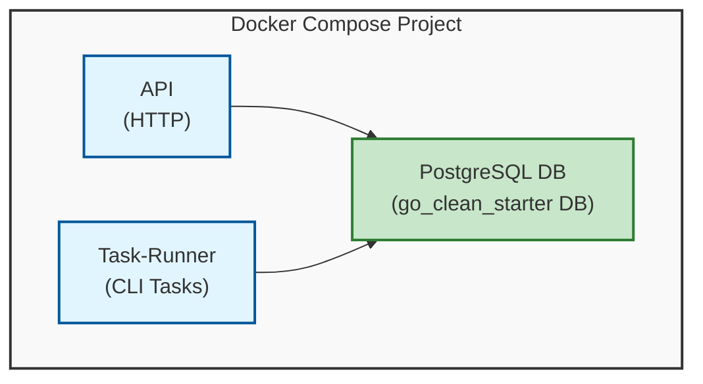

# go-clean-starter

[🇯🇵 **日本語**](./README_JA.md)

This is a Go template of clean architecture to ease and boost up a backend development with up to date libraries utilizing clean architecture as design.

## Requirements
| Name | Used for |
|-|-|
| [Go](https://go.dev/) | for backend application |
| [Docker and docker-compose](https://www.docker.com/) | for containers |
| [goimports](https://pkg.go.dev/golang.org/x/tools/cmd/goimports) | for formatting source code |
| [golangci-lint](https://github.com/golangci/golangci-lint) | for linting source code |

## Overview
This app has three containers.
- `api` to run api server
- `task` to run task
- `postgres` for database

### Architecture


### Key Technologies
- **Go**: Primary language for high performance, simplicity, and strong concurrency support
- **Echo**: Fast and lightweight HTTP web framework with clean routing and rich middleware support
- **PostgreSQL**: Reliable database with advanced features like JSONB, full-text search, and strong consistency
- **sqlc**: Generates type-safe Go code from raw SQL queries for compile-time safety and better performance
- **golang-migrate**: Handles database schema migrations with version control, locking, and rollback support
- **oapi-codegen**: Generates Go structs and types from OpenAPI specifications for type-safe API development
- **Manual Dependency Injection**: Simple and explicit dependency management using plain Go constructors
- **Air**: Hot reload tool for fast development cycles with automatic rebuilds on file changes
- **Docker & Docker Compose**: Containerization for consistent development and deployment environments

### Directory structure

```bash
go-clean-starter
├── builder
│   ├── builder.go      # manual dependency injection initialization
│   └── dependency.go   # dependency resolution and setup
├── cmd
│   ├── migration.go    # command to run migration
│   ├── serve.go        # command to run API server
│   └── task.go         # commands to run tasks (currently only one task is defined here)
├── config
├── domain # domain models
├── go.sum
├── internal
│   ├── http # http layer
│   │   ├── base
│   │   ├── handler
│   │   │   ├── errors.go
│   │   │   ├── openapi_types.gen.go # auto generated Go structs by doc/api.yaml
│   │   │   └── user
│   │   ├── middleware
│   │   └── server.go
│   ├── repository # data access layer
│   │   ├── item
│   │   ├── user
│   │   └── transaction.go
│   ├── service # business logic layer
│   │   └── user
│   ├── sqlc # sqlc input & output
│   │   ├── query
│   │   │   ├── items.sql
│   │   │   └── users.sql
│   │   ├── db.go
│   │   ├── items.sql.go
│   │   ├── models.go
│   │   └── users.sql.go
│   └── task # task program such as job, batch, etc...
│       └── item
│           ├── data
│           │   └── item.csv
│           ├── item.go
│           └── usecase.go
├── main.go
├── migration
│   ├── migrate.go
│   └── sql # migration sql files
├── pkg                         # pkg is empty now. add packages that can be imported by other projects
├── README.md
├── WHY.md                      # document to explain why this tech stack and tech specifications are choosen
├── docker-compose.test.yaml
├── docker-compose.yaml
└── sqlc.yaml                    # configuration of sqlc
```

## Quick Start

For first-time setup, run:
```bash
make quickstart
```

This command will:
1. Copy `.env.example` to `.env` (if not exists)
2. Build and start all containers

The API will be available at `http://localhost:8080`

💡 This project uses **[air](https://github.com/air-verse/air)**, which is Go hot reload. Hot reload helps us to develop faster.

## PostgreSQL upgrades

Both Compose environments use `postgres:18`. The volume is mounted at `/var/lib/postgresql`, with the image storing data in `/var/lib/postgresql/18/docker`.

An existing PostgreSQL 15 volume cannot be used directly by PostgreSQL 18. Before switching, stop application writes and back up the database using the PostgreSQL 15 container. Restore into a fresh PostgreSQL 18 volume and verify the data before removing the old volume. Changing the image tag does not migrate data; the project's SQL migrations only manage the application schema. See the [PostgreSQL upgrade guide](https://www.postgresql.org/docs/18/upgrading.html).

For disposable development or test databases, the corresponding Compose project's volumes can be removed and recreated instead. Removing volumes permanently deletes their data; do this only when the data is no longer needed.

## Test
- run `make test` to test
`make test` will create a test environment using the test specific [docker-compose.test.yaml](./docker-compose.test.yaml) with the same [Dockerfile](./Dockerfile) as development.
Thus safety of test environment is assured as it's separated from local environment for development.

```bash
make test
```

The [CI workflow](./.github/workflows/ci.yml) checks module checksums and tidy state, runs `make test` with PostgreSQL 18, and builds and smoke-tests the runtime image on pull requests and pushes to `main`. Failed checks must be investigated before merging dependency updates; a skipped bot review is not a passing test.

## API Usage

Once the server is running, you can interact with the API:

📋 **Complete API documentation is available in [`api.yaml`](./api.yaml)** - OpenAPI 3.1 specification with all endpoints, schemas, and examples.

### Health Check
```bash
curl http://localhost:8080/health
```

### Getting Help
- Check [Issues](https://github.com/SoraDaibu/go-clean-starter/issues) for known problems
- Review [WHY.md](./WHY.md) for architecture decisions

## Contributions
read [CONTRIUTING.md](./CONTRIBUTING.md) to contribute to this project.
